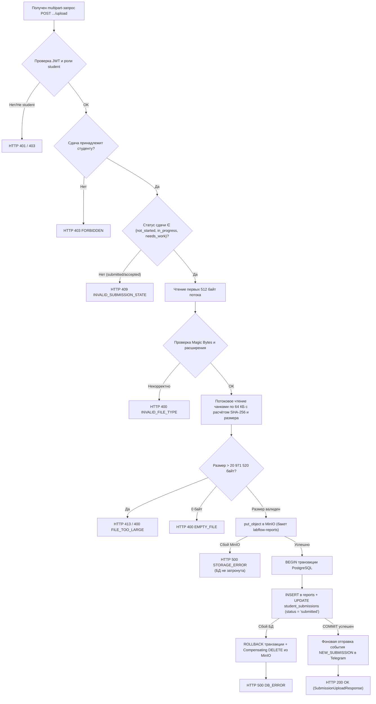

# Спецификация контрактов API загрузки файлов через MinIO (WBS 4.4.8) — Проект LabFlow

**Задача ИСР:** [[wbs-4-4-8|4.4.8. [Аналитик] Детализация требований и контрактов API загрузки файлов через MinIO.]]  
**Исполнитель:** Пашковский Владимир (Роль: Аналитик)  
**Период выполнения:** 16–17 ноября 2026 г.  
**Получатели артефакта:**  
- Теплов А. (Backend MinIO — `4.4.2`, `4.4.3`)  
- Мельников Д. (PM / Backend Auth — `4.4.2`)  
- Пашковский В. (Frontend — `4.4.4`, `4.4.5`)  
- Кулов Д. (QA — `4.4.6`, `4.4.7`)  
- Паршин А. (Lead Dev — `4.6.1`)  
**Статус документа:** Утверждено. Технический контракт для реализации модуля отчётов в FastAPI, клиентских вызовов в React/TypeScript и сценариев тестирования QA.  
**Связанные документы:** [[Требования к загрузке и скачиванию файлов (MinIO)|Спецификация хранилища MinIO (4.4.1)]], [[Спецификация API (OpenAPI)]], [[Схема базы данных (ERD)]], [[Матрица ролей и прав доступа]], [[Матрица трассировки требований (RTM)]], [[Definition of Done]]

---

## 1. Назначение документа и архитектурные решения

Настоящий документ фиксирует строгие технические контракты REST API для модуля **«Отчёты и комментарии» (WBS 4.4)** сервиса LabFlow. Документ детализирует спецификацию требований [[Требования к загрузке и скачиванию файлов (MinIO)|WBS 4.4.1]] до уровня точных HTTP-заголовков, схем `multipart/form-data`, JSON payload, моделей Pydantic v2, TypeScript-интерфейсов и компенсирующих алгоритмов обработки транзакционных сбоев.

### 1.1. Базовые архитектурные принципы
1. **Проксирование загрузки через FastAPI (Backend Upload Proxy):**
   - Клиент загружает файл на бэкенд по `POST /api/v1/submissions/{submission_id}/upload` (`multipart/form-data`).
   - Прямой PUT-доступ клиента в MinIO запрещён. Это гарантирует аутентификацию (JWT), проверку владения сдачей (ABAC), проверку статуса (только `not_started`, `in_progress`, `needs_work`), потоковую проверку magic bytes и вычисление SHA-256 до сохранения метаданных в PostgreSQL.
2. **Скачивание через временный Pre-signed GET URL:**
   - Бэкенд формирует временную криптографически подписанную ссылку через `GET /api/v1/submissions/{submission_id}/download-url`.
   - Время жизни ссылки (TTL) — строго **15 минут (900 секунд)**.
   - Ссылка содержит принудительный заголовок `response-content-disposition: attachment; filename*=UTF-8''...` (Anti-XSS).
3. **Решение проблемы адресации MinIO в Docker-окружении:**
   - Внутри Docker-сети бэкенд связывается с хранилищем по адресу `http://minio:9000`.
   - Клиент (браузер) обращается снаружи по адресу `http://localhost:9000` (или через обратный прокси Nginx).
   - Для предотвращения ошибки AWS Signature Version 4 `SignatureDoesNotMatch` при генерации pre-signed ссылок на бэкенде используется переменная окружения **`MINIO_PUBLIC_ENDPOINT`** (например, `http://localhost:9000`). Клиент S3 инициализируется с внешним endpoint либо URL переписывается с сохранением параметров подписи.
4. **Атомарность и версионность (US-09, DoD D7):**
   - Файлы отчётов физически сохраняются в приватном бакете `MINIO_BUCKET_REPORTS` (по умолчанию `labflow-reports`).
   - При повторной сдаче после доработки (`needs_work`) старый файл **не перезаписывается и не удаляется**, а сохраняется под уникальным ключом с новой временной меткой.
   - В БД (`WBS 4.4.2`) создаётся таблица `reports` со связью `1:N` к `student_submissions`, хранящая номер версии (`version_number`), путь в MinIO, SHA-256 и метаданные.
   - При ошибке записи в БД после успешной загрузки в MinIO вызывается компенсирующее удаление объекта из бакета.

---

## 2. Спецификация эндпоинтов API

### 2.1. Загрузка файла отчёта студентом

```http
POST /api/v1/submissions/{submission_id}/upload
```

#### Назначение
Загрузка отчёта по лабораторной работе студентом. Выполняет первичную сдачу либо повторную сдачу после отправки на доработку. При успехе переводит сдачу в статус `submitted`, вычисляет SHA-256, сохраняет версию отчёта и инициирует асинхронное событие `NEW_SUBMISSION` для Telegram-бота.

#### Права доступа (RBAC / ABAC)
- **Только аутентифицированный пользователь** (`BearerAuth`).
- **Роль:** строго `student` (`users.role_id ➔ roles.code == 'student'`).
- **ABAC:** `submission.student_id == current_user.id` (запрещено загружать отчёт в карточку чужого студента).
- **Валидация бизнес-статуса:** сдача должна находиться в статусе `not_started`, `in_progress` или `needs_work`. При статусах `submitted` или `accepted` возвращается ошибка `409 Conflict`.

#### Параметры пути (Path Parameters)
| Параметр | Тип | Обязательный | Описание |
|---|---|:---:|---|
| `submission_id` | `integer` (или `uuid`) | Да | Идентификатор записи сдачи в `student_submissions` |

#### Заголовки запроса (Request Headers)
| Заголовок | Значение | Описание |
|---|---|---|
| `Authorization` | `Bearer <access_jwt_token>` | JWT-токен студента |
| `Content-Type` | `multipart/form-data; boundary=...` | Стандартный заголовок отправки формы с файлом |

#### Тело запроса (Request Body: `multipart/form-data`)
| Поле | Тип | Обязательность | Ограничения и валидация |
|---|---|:---:|---|
| `file` | `binary` | Да | - Расширения: строго `.pdf`, `.docx`, `.zip`<br>- Размер: строго `1 байт ≤ size ≤ 20 971 520 байт` (20 МБ)<br>- Magic bytes: PDF (`%PDF-`), DOCX (`PK\x03\x04` + `[Content_Types].xml`), ZIP (`PK\x03\x04`) |

#### Формирование ключа объекта в MinIO (Object Key)
```text
submissions/{lab_work_id}/{student_id}/{utc_timestamp}_{short_uuid}_{sanitized_filename}
```
*Пример:* `submissions/1/42/20261117T143000Z_a1b2c3d4_LR1_Ivanov_VPR42.pdf`

---

#### Ответы сервера (Responses)

##### Успешный ответ: `200 OK`
Возвращает обновлённую карточку сдачи и метаданные сохранённой версии отчёта.

```json
{
  "submission": {
    "id": 15,
    "lab_work_id": 1,
    "lab_work_title": "ЛР №1: Основы Git и командной разработки",
    "student_id": 42,
    "student_name": "Иванов Иван Иванович",
    "group_name": "ВПР42",
    "status": "submitted",
    "file_name": "LR1_Ivanov_VPR42.pdf",
    "file_size_bytes": 2457600,
    "submitted_at": "2026-11-17T14:30:00Z",
    "updated_at": "2026-11-17T14:30:00Z"
  },
  "report": {
    "id": 8,
    "submission_id": 15,
    "version_number": 1,
    "file_name": "LR1_Ivanov_VPR42.pdf",
    "file_size_bytes": 2457600,
    "file_mime_type": "application/pdf",
    "file_sha256": "e3b0c44298fc1c149afbf4c8996fb92427ae41e4649b934ca495991b7852b855",
    "uploaded_at": "2026-11-17T14:30:00Z"
  },
  "message": "Отчёт успешно загружен и передан на проверку"
}
```

##### Ошибка валидации: `400 Bad Request`
Возвращается при нарушении формата файла, пустом файле или некорректной структуре:

```json
{
  "code": "INVALID_FILE_TYPE",
  "message": "Допустимы только корректные файлы форматов PDF, DOCX, ZIP",
  "details": [
    {
      "field": "file",
      "issue": "Несоответствие сигнатуры файла (magic bytes) расширению .pdf"
    }
  ]
}
```

*При пустом файле (0 байт):*
```json
{
  "code": "EMPTY_FILE",
  "message": "Файл отчёта не выбран или является пустым (0 байт)",
  "details": []
}
```

##### Ошибка размера файла: `413 Payload Too Large` (или `400 Bad Request`)
Возвращается при превышении лимита 20 МБ (`> 20 971 520` байт):

```json
{
  "code": "FILE_TOO_LARGE",
  "message": "Размер файла превышает максимально допустимый лимит 20 МБ (20 971 520 байт)",
  "details": [
    {
      "field": "file",
      "issue": "Получено байт: 25165824, лимит: 20971520"
    }
  ]
}
```

##### Ошибка неавторизованного доступа: `401 Unauthorized`
```json
{
  "code": "UNAUTHORIZED",
  "message": "Требуется аутентификация в системе"
}
```

##### Ошибка прав доступа: `403 Forbidden`
Возвращается при попытке преподавателя вызвать загрузку либо студента загрузить файл в чужую сдачу:
```json
{
  "code": "FORBIDDEN",
  "message": "Вы не можете загружать отчёт для данной сдачи"
}
```

##### Ошибка отсутствия ресурса: `404 Not Found`
```json
{
  "code": "NOT_FOUND",
  "message": "Сдача с указанным идентификатором не найдена"
}
```

##### Ошибка конфликта статуса: `409 Conflict`
Возвращается, если работа уже находится в статусе `submitted` (на проверке) или `accepted` (принята):
```json
{
  "code": "INVALID_SUBMISSION_STATE",
  "message": "Повторная загрузка недоступна: работа уже сдана или принята",
  "details": [
    {
      "field": "status",
      "issue": "Текущий статус 'submitted'. Повторная загрузка возможна только в статусе 'needs_work'"
    }
  ]
}
```

##### Внутренний сбой хранилища/БД: `500 Internal Server Error`
```json
{
  "code": "STORAGE_ERROR",
  "message": "Сбой сохранения файла в объектном хранилище MinIO. Попробуйте повторить попытку позже"
}
```

---

### 2.2. Получение временного Pre-signed URL на скачивание отчёта

```http
GET /api/v1/submissions/{submission_id}/download-url
```

#### Назначение
Формирует криптографически подписанную временную ссылку для безопасного прямого скачивания файла отчёта из MinIO.

#### Права доступа (RBAC / ABAC)
- **Студент:** разрешено скачивание **только своего** отчёта (`submission.student_id == current_user.id`). Попытка скачать файл одногруппника блокируется кодом `403 Forbidden`.
- **Преподаватель:** разрешено скачивание отчёта **любого студента** курируемой группы (`users.group_name == submission.student.group_name`).

#### Параметры запроса (Query Parameters)
| Параметр | Тип | Обязательность | Описание |
|---|---|:---:|---|
| `version_id` | `integer` | Нет | Идентификатор конкретной версии отчёта из таблицы `reports`. Если не передан — скачивается последняя актуальная версия |

#### Ответы сервера (Responses)

##### Успешный ответ: `200 OK`
```json
{
  "download_url": "http://localhost:9000/labflow-reports/submissions/1/42/20261117T143000Z_a1b2c3d4_LR1_Ivanov.pdf?X-Amz-Algorithm=AWS4-HMAC-SHA256&X-Amz-Credential=minioadmin%2F20261117%2Fus-east-1%2Fs3%2Faws4_request&X-Amz-Date=20261117T143005Z&X-Amz-Expires=900&X-Amz-SignedHeaders=host&response-content-disposition=attachment%3B%20filename%2A%3DUTF-8%27%27LR1_Ivanov_VPR42.pdf&response-content-type=application%2Fpdf&X-Amz-Signature=5f18c...",
  "file_name": "LR1_Ivanov_VPR42.pdf",
  "file_size_bytes": 2457600,
  "file_sha256": "e3b0c44298fc1c149afbf4c8996fb92427ae41e4649b934ca495991b7852b855",
  "expires_in_seconds": 900
}
```

##### Файл ещё не загружен: `400 Bad Request`
Если студент находится в статусе `not_started` или `in_progress` и файл ещё ни разу не прикреплялся:
```json
{
  "code": "FILE_NOT_UPLOADED",
  "message": "Для данной сдачи файл отчёта ещё не был загружен"
}
```

##### Ошибка доступа: `403 Forbidden`
```json
{
  "code": "FORBIDDEN",
  "message": "Доступ запрещён: вы можете скачивать только свои сданные отчёты"
}
```

---

### 2.3. История версий отчётов сдачи

```http
GET /api/v1/submissions/{submission_id}/reports
```

#### Назначение
Возвращает список всех когда-либо загруженных студентом версий отчётов по данной сдаче (включая первичные и исправленные после доработки по `US-09`).

#### Права доступа
- **Студент-владелец** (`submission.student_id == current_user.id`).
- **Преподаватель** группы.

#### Успешный ответ: `200 OK`
```json
{
  "total": 2,
  "items": [
    {
      "id": 12,
      "submission_id": 15,
      "version_number": 2,
      "file_name": "LR1_Ivanov_v2_fixed.pdf",
      "file_size_bytes": 2510000,
      "file_mime_type": "application/pdf",
      "file_sha256": "7a35...c12",
      "uploaded_at": "2026-11-17T18:10:00Z"
    },
    {
      "id": 8,
      "submission_id": 15,
      "version_number": 1,
      "file_name": "LR1_Ivanov_VPR42.pdf",
      "file_size_bytes": 2457600,
      "file_mime_type": "application/pdf",
      "file_sha256": "e3b0...b55",
      "uploaded_at": "2026-11-17T14:30:00Z"
    }
  ]
}
```

---

### 2.4. Рецензирование и комментарии к работе

#### 2.4.1. Добавление комментария преподавателем
```http
POST /api/v1/submissions/{submission_id}/comments
```
- **Доступ:** только `teacher`.
- **Тело запроса (`application/json`):**
  ```json
  {
    "text": "В отчёте отсутствует вывод по разделу 2. Исправьте конфигурацию Git и перезалейте файл."
  }
  ```
- **Ограничения:** длина от 5 до 2000 символов. Обязательная очистка пробелов (`strip()`). Автоматическое экранирование HTML (`html.escape`) перед отправкой уведомления в Telegram.
- **Ответ `201 Created`:**
  ```json
  {
    "id": 104,
    "submission_id": 15,
    "author_id": 2,
    "author_name": "Петров Пётр Петрович",
    "author_role": "teacher",
    "text": "В отчёте отсутствует вывод по разделу 2. Исправьте конфигурацию Git и перезалейте файл.",
    "created_at": "2026-11-17T15:00:00Z"
  }
  ```

#### 2.4.2. Получение списка комментариев
```http
GET /api/v1/submissions/{submission_id}/comments
```
- **Доступ:** студент-владелец сдачи и преподаватели.
- **Ответ `200 OK`:** массив объектов `CommentResponse`, отсортированных по возрастанию `created_at`.

---

## 3. Спецификация структур данных (Data Dictionary для Backend)

Настоящий раздел фиксирует требования к структурам данных, ограничениям и валидаторам, которые бэкенд-разработчик реализует в рамках задачи **4.4.3** (`backend/app/schemas/`):

### 3.1. Модель версии отчёта (`Report` / `ReportResponse`)
Представляет метаданные конкретного файла отчёта, привязанного к сдаче:

| Поле | Тип | Обязательность | Ограничения и правила валидации | Описание |
|---|---|:---:|---|---|
| `id` | `integer` | Да | PK, auto-increment | Идентификатор версии отчёта |
| `submission_id` | `integer` | Да | FK ➔ `student_submissions.id` | Ссылка на карточку сдачи |
| `version_number` | `integer` | Да | `>= 1`, автоинкремент для сдачи | Порядковый номер версии отчёта (1, 2, ...) |
| `file_name` | `string` | Да | Длина: 1..255 символов | Оригинальное отображаемое имя файла |
| `file_size_bytes` | `integer` | Да | `1 ≤ size ≤ 20 971 520` (до 20 МБ) | Физический размер файла в байтах |
| `file_mime_type` | `string` | Да | Длина: до 120 символов | MIME-тип содержимого (`application/pdf`, и т.д.) |
| `file_sha256` | `string` | Да | Ровно 64 hex-символа | Контрольная сумма SHA-256 для верификации целостности |
| `uploaded_at` | `datetime` | Да | UTC timestamp с таймзоной | Дата и время фактической загрузки |

### 3.2. Модель ответа при скачивании (`PresignedDownloadResponse`)
Возвращается клиенту для безопасного прямого скачивания файла из хранилища:

| Поле | Тип | Обязательность | Формат / Значение | Описание |
|---|---|:---:|---|---|
| `download_url` | `string (URI)` | Да | Сформированный AWS SigV4 URL | Временная ссылка на скачивание файла из MinIO |
| `file_name` | `string` | Да | Исходное имя файла | Имя для заголовка `Content-Disposition` |
| `file_size_bytes` | `integer` | Да | Целое число байт | Размер скачиваемого файла |
| `file_sha256` | `string` | Да | 64 hex-символа | Контрольная сумма SHA-256 |
| `expires_in_seconds` | `integer` | Да | Константа: `900` | Срок действия ссылки в секундах (15 минут) |

### 3.3. Модель ответа при загрузке (`SubmissionUploadResponse`)
Возвращается при успешной отправке отчёта студентом (`POST .../upload`):

| Поле | Тип | Обязательность | Описание |
|---|---|:---:|---|
| `submission` | `SubmissionResponse` | Да | Актуализированная карточка сдачи (статус `submitted`, даты) |
| `report` | `ReportResponse` | Да | Созданная запись версии отчёта с метаданными и хешем |
| `message` | `string` | Да | Уведомление: «Отчёт успешно загружен и передан на проверку» |

### 3.4. Модели рецензирования и комментариев (`Comment`)
Используются при проверке работ преподавателем:

- **Создание комментария (`CommentCreateRequest`):**
  - `text`: строка от 5 до 2000 символов.
  - Правило валидации: очистка концевых пробелов (`strip()`). Строка из одних пробелов либо значащий текст короче 5 символов отклоняется ошибкой `400 Bad Request`.
- **Просмотр комментария (`CommentResponse`):**
  - `id`: идентификатор комментария (`integer`).
  - `submission_id`: ссылка на сдачу (`integer`).
  - `author_id`: идентификатор автора (`integer`).
  - `author_name`: ФИО автора (`string`).
  - `author_role`: роль автора (`student` или `teacher`).
  - `text`: текст замечания (`string`).
  - `created_at`: дата и время создания (`datetime UTC`).

### 3.5. Модель унифицированной ошибки (`ErrorResponse`)
Возвращается при всех ошибках бизнес-логики и валидации:

| Поле | Тип | Обязательность | Описание |
|---|---|:---:|---|
| `code` | `string` | Да | Машиночитаемый код ошибки (`INVALID_FILE_TYPE`, `FILE_TOO_LARGE`, `EMPTY_FILE`, `INVALID_SUBMISSION_STATE`, `FILE_NOT_UPLOADED`, `STORAGE_ERROR`, `DB_ERROR`) |
| `message` | `string` | Да | Понятное описание ошибки на русском языке для отображения пользователю |
| `details` | `array` | Нет | Детализация нарушений: массив объектов `{ field: string, issue: string }` |

---

## 4. Требования к интеграции клиентского слоя (Frontend для задачи 4.4.5)

Настоящий раздел определяет требования к методам и форматам запросов, которые фронтенд-разработчик реализует в рамках задачи **4.4.5** (`frontend/src/api/submissionsApi.ts`):

### 4.1. Спецификация API-методов клиента

| Метод клиента | Эндпоинт и HTTP-метод | Формат запроса | Ожидаемый ответ | Ответственность фронтенда |
|---|---|---|---|---|
| `uploadReport(submissionId, file)` | `POST /api/v1/submissions/{id}/upload` | `multipart/form-data`, поле `file` | `SubmissionUploadResponse` | - Клиентская валидация расширения (`.pdf`, `.docx`, `.zip`) и размера (`≤ 20 МБ`) до отправки трафика<br>- Индикация прогресса (прогресс-бар / спиннер)<br>- Блокировка кнопки повторной отправки во время запроса |
| `getDownloadUrl(submissionId, versionId?)` | `GET /api/v1/submissions/{id}/download-url` | Query: `?version_id=...` (опционально) | `PresignedDownloadResponse` | - Получение временного URL<br>- Инициация автоматического скачивания файла браузером по ссылке `download_url` |
| `getReportsHistory(submissionId)` | `GET /api/v1/submissions/{id}/reports` | Без тела | `{ total: number, items: ReportResponse[] }` | - Отображение списка всех загруженных версий отчётов студента в карточке сдачи (US-09) |
| `getComments(submissionId)` | `GET /api/v1/submissions/{id}/comments` | Без тела | `CommentResponse[]` | - Отображение диалога замечаний преподавателя |
| `addComment(submissionId, text)` | `POST /api/v1/submissions/{id}/comments` | `application/json`: `{ text }` | `CommentResponse` | - Доступно только в интерфейсе преподавателя<br>- Блокировка отправки пустого текста (< 5 символов) |

> **Важно для разработчика интерфейса (`4.4.4`, `4.4.5`):** все ошибки от бэкенда приходят в унифицированном формате `ErrorResponse`. Обработка должна строиться по полю `code` (например, при коде `INVALID_SUBMISSION_STATE` блокировать форму, при `FILE_TOO_LARGE` подсвечивать ограничение 20 МБ).

---

## 5. Алгоритм потоковой валидации и отказоустойчивости (Backend)



---

## 6. Согласование с командой и статус задач

| Команда / Роль | Задача | Требования из контракта 4.4.8 |
|---|---|---|
| **Backend (Теплов А., Мельников Д.)** | `4.4.2`, `4.4.3` | Создать таблицу `reports`, настроить приватный бакет `labflow-reports`, внедрить сервис `MinioStorageService` с `MINIO_PUBLIC_ENDPOINT`, реализовать compensating delete при сбоях БД |
| **Frontend (Пашковский В.)** | `4.4.4`, `4.4.5` | Реализовать форму загрузки с drag-and-drop, клиентскую валидацию расширений и размера ≤ 20 МБ, индикацию ошибок по машиночитаемым кодам `ErrorResponse.code` |
| **QA (Кулов Д., Пашковский В.)** | `4.4.6`, `4.4.7` | Проверить все позитивные и негативные кейсы по разработанному тест-плану |
