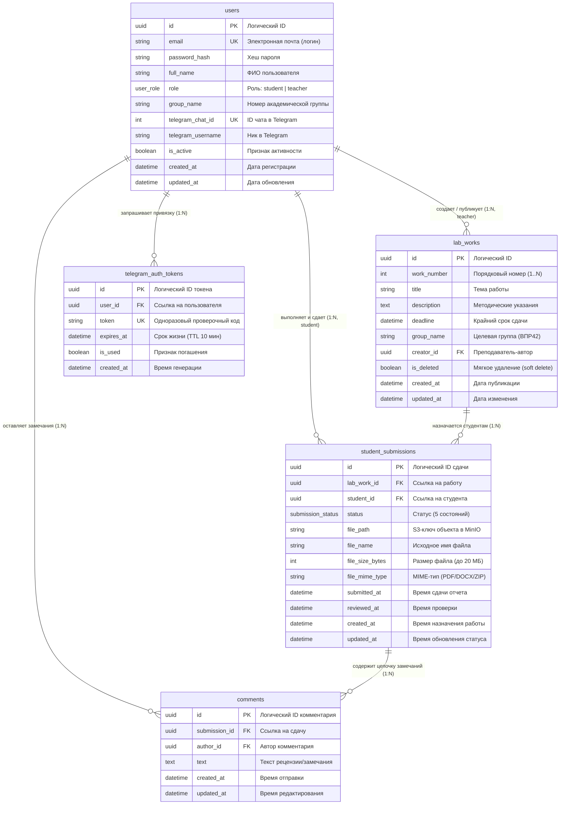

# Спецификация модели данных: ER-диаграмма и Словарь данных (Data Dictionary)

**Проект:** Сервис сдачи и отслеживания лабораторных работ «LabFlow» (группа ВПР42)  
**Задача ИСР:** 3.1.3. [Аналитик] Описание API (OpenAPI-спецификация), схема БД, матрица ролей и прав доступа; актуализация — [[6.1.1.-[аналитик]-ведение-документации-в-obsidian--user-stor|6.1.1]]  
**Автор документа:** Пашковский Владимир (Роль: Аналитик)  
**Получатели артефакта:** Мельников Д. (PM / Backend Auth), Паршин А. (Lead Dev Backend CRUD), Теплов А. (Backend Telegram & Storage), Кулов Д. (QA)  
**Статус документа:** Утверждено; дополнено ссылками на детализацию таблиц для WBS 4.4.2 и 4.5.2 (11 ноября 2026 г.)  

---

## 1. Назначение документа и роль аналитика

В соответствии с методологией системного анализа, аналитик не создает физические файлы миграций в кодовой базе бэкенда (это прямая зона ответственности Backend-разработчиков в рамках задач 4.1.2, 4.2.2, 4.3.2, 4.5.2). 

**Задача аналитика** — предоставить формализованную модель данных, состоящую из:
1. **ER-диаграммы (Entity-Relationship Diagram):** графической схемы сущностей предметной области и кардинальности связей между ними (1:1, 1:N, N:M).
2. **Словаря данных (Data Dictionary):** исчерпывающего каталога сущностей и атрибутов, где для каждого поля зафиксированы логическое и физическое наименования, тип данных, обязательность, уникальность, а также бизнес-правила валидации и консистентности.
3. **Бизнес-инвариантов целостности:** правил каскадности, ограничений предметной области и жизненного цикла данных.

---

## 2. ER-диаграмма предметной области (Entity-Relationship Diagram)

### 2.1. Визуальная схема сущностей и связей

Диаграмма описывает 5 ключевых сущностей сервиса LabFlow и их ассоциации:
* `users` (Пользователи системы: студенты и преподаватели);
* `lab_works` (Лабораторные работы учебной программы);
* `student_submissions` (Карточки сдачи и прогресс студентов по работам);
* `comments` (Рецензии и замечания к сданным отчетам);
* `telegram_auth_tokens` (Временные токены связывания с Telegram-ботом).

---

### 2.2. Матрица связей между сущностями (Cardinality & Constraints)

| Родительская сущность | Дочерняя сущность | Связь | Обязательность | Бизнес-правило связи | Поведение при удалении родителя |
|---|---|:---:|:---:|---|---|
| `users` (Преподаватель) | `lab_works` | **1 : N** | 1 (обяз.) : 0..N | Преподаватель может создать множество лабораторных работ. Работа не может существовать без автора. | `RESTRICT` (запрещено удалять преподавателя, если у него есть привязанные работы). |
| `users` (Студент) | `student_submissions` | **1 : N** | 1 (обяз.) : 0..N | Студент имеет персональные карточки сдачи по каждой опубликованной работе его группы. | `RESTRICT` (запрещено удалять студента с историей сданных работ). |
| `lab_works` | `student_submissions` | **1 : N** | 1 (обяз.) : 0..N | По каждой работе создаются карточки сдачи для всех студентов группы. Сочетание `(lab_work_id, student_id)` строго уникально. | `RESTRICT` (физическое удаление запрещено, используется логический флаг `is_deleted = true`). |
| `student_submissions` | `comments` | **1 : N** | 1 (обяз.) : 0..N | К одной сдаче может быть оставлено произвольное количество замечаний и рецензий преподавателя. | `CASCADE` (при удалении карточки сдачи каскадно удаляются все комментарии к ней). |
| `users` | `comments` | **1 : N** | 1 (обяз.) : 0..N | Комментарий обязан иметь автора (преподаватель или студент). | `RESTRICT` (удаление автора запрещено). |
| `users` | `telegram_auth_tokens` | **1 : N** | 1 (обяз.) : 0..N | Пользователь может генерировать токены для привязки Telegram-бота. | `CASCADE` (при удалении пользователя временные токены удаляются). |

---

## 3. Словарь данных (Data Dictionary)

### 3.1. Перечисления предметной области (Enumerations)

#### 1. Роли пользователей (`user_role`)
* **`student`** — Студент академической группы. Доступ: просмотр назначенных работ группы, смена статуса на «В работе», загрузка файла отчета (PDF/DOCX/ZIP до 20 МБ), просмотр комментариев, получение уведомлений.
* **`teacher`** — Преподаватель. Доступ: создание, редактирование, мягкое удаление лабораторных работ, просмотр ведомости сдачи группы, скачивание отчетов, оставление комментариев, выставление статусов «Принята» / «На доработке».

#### 2. Жизненный цикл сдачи (`submission_status`)
* **`not_started`** (Не начата) — начальный статус, присваиваемый автоматически при назначении работы группе.
* **`in_progress`** (В работе) — статус выставляется студентом вручную при начале выполнения работы.
* **`submitted`** (Сдана) — статус выставляется автоматически при успешной загрузке файла отчета студентом.
* **`needs_work`** (На доработке) — выставляется преподавателем при наличии замечаний к отчету (требуется исправление).
* **`accepted`** (Принята) — финальный положительный вердикт преподавателя, защита зачтена.

---

### 3.2. Сущность «Пользователи» (`users`)
**Описание:** Учетные записи участников образовательного процесса (студентов и преподавателей).

| Физическое имя | Логическое имя | Тип данных | Обязательность / Ключ | Бизнес-смысл и правила заполнения (валидация) |
|---|---|---|:---:|---|
| `id` | Идентификатор пользователя | UUID | **PK**, NOT NULL | Суррогатный первичный ключ. Генерируется автоматически (`gen_random_uuid()`). Защищает от перебора IDOR. |
| `email` | Адрес электронной почты | Строка (до 255) | **UK**, NOT NULL | Логин для входа в сервис. Валидный email. Проверка уникальности без учета регистра символов (`LOWER(email)`). |
| `password_hash` | Хеш пароля | Строка (до 255) | NOT NULL | Криптографический хеш пароля (Argon2id или bcrypt с солью). Открытые пароли никогда не хранятся в БД. |
| `full_name` | ФИО пользователя | Строка (до 150) | NOT NULL | Полное имя (Фамилия Имя Отчество). Длина не менее 2 непробельных символов (`char_length(trim) >= 2`). |
| `role` | Роль в системе | `user_role` | NOT NULL | Определяет права в системе. Принимает значение `student` или `teacher`. |
| `group_name` | Учебная группа | Строка (до 50) | Опционально / Условное | **Бизнес-правило:** Если `role = 'student'`, поле **обязательно** для заполнения (для MVP строго `'ВПР42'`). Если `role = 'teacher'`, значение строго `NULL`. |
| `telegram_chat_id` | Идентификатор чата Telegram | Большое целое (Int64) | **UK**, Опционально | Уникальный числовой Telegram ID пользователя. Заполняется при успешной привязке бота через deep-link. |
| `telegram_username` | Имя пользователя в Telegram | Строка (до 100) | Опционально | Никнейм пользователя в Telegram (без `@`) для отображения в профиле и интерфейсе ведомости. |
| `is_active` | Признак активности аккаунта | Булево | NOT NULL, По умолч.: `true` | Флаг блокировки учетной записи (при отчислении студента или увольнении преподавателя вход блокируется). |
| `created_at` | Дата и время регистрации | Дата и время (TZ) | NOT NULL, По умолч.: `NOW` | Момент фиксации учетной записи в системе. |
| `updated_at` | Дата и время обновления | Дата и время (TZ) | NOT NULL, По умолч.: `NOW` | Момент последнего изменения персональных данных профиля. |

---

### 3.3. Сущность «Лабораторные работы» (`lab_works`)
**Описание:** Учебные задания, сформированные преподавателем для академической группы.

| Физическое имя | Логическое имя | Тип данных | Обязательность / Ключ | Бизнес-смысл и правила заполнения (валидация) |
|---|---|---|:---:|---|
| `id` | Идентификатор работы | UUID | **PK**, NOT NULL | Суррогатный первичный ключ. Генерируется автоматически. |
| `work_number` | Номер лабораторной работы | Целое число | NOT NULL | Порядковый номер работы в учебном плане (1, 2, 3...). Должен быть строго больше 0 (`work_number > 0`). |
| `title` | Название работы | Строка (до 255) | NOT NULL | Краткая тема работы (например, «ЛР №1: Основы Git и CI/CD»). Длина от 3 символов. |
| `description` | Описание и методические указания | Текст (TEXT) | NOT NULL | Полные требования к выполнению, ссылки на репозитории, методички и критерии оценивания. |
| `deadline` | Срок сдачи (дедлайн) | Дата и время (TZ) | NOT NULL | Крайний срок отправки отчета без штрафа. **Бизнес-правило:** При создании работы дедлайн обязан быть позже текущего времени (`deadline > created_at`). |
| `group_name` | Целевая учебная группа | Строка (до 50) | NOT NULL, По умолч.: `'ВПР42'` | Группа, которой выдано задание. В MVP поддерживается фиксированная группа `'ВПР42'`. |
| `creator_id` | Идентификатор автора работы | UUID | **FK**, NOT NULL | Ссылка на пользователя-преподавателя (`users.id`). |
| `is_deleted` | Признак мягкого удаления | Булево | NOT NULL, По умолч.: `false` | Позволяет скрыть работу из активного списка без нарушения целостности и потери отчетов студентов. |
| `created_at` | Дата и время публикации | Дата и время (TZ) | NOT NULL, По умолч.: `NOW` | Момент публикации задания для студентов. |
| `updated_at` | Дата и время изменения | Дата и время (TZ) | NOT NULL, По умолч.: `NOW` | Момент последнего редактирования задания преподавателем. |

**Составное бизнес-ограничение уникальности:**
* В рамках одной учебной группы не может существовать двух неудаленных работ с одинаковым порядковым номером: `UNIQUE (group_name, work_number) WHERE is_deleted = false`.

---

### 3.4. Сущность «Сдачи работ студентами» (`student_submissions`)
**Описание:** Запись прогресса конкретного студента по конкретной лабораторной работе, включая статус, прикрепленный отчет и результат проверки.

| Физическое имя | Логическое имя | Тип данных | Обязательность / Ключ | Бизнес-смысл и правила заполнения (валидация) |
|---|---|---|:---:|---|
| `id` | Идентификатор записи сдачи | UUID | **PK**, NOT NULL | Первичный ключ строки ведомости. |
| `lab_work_id` | Идентификатор лабораторной работы | UUID | **FK**, NOT NULL | Ссылка на задание (`lab_works.id`). |
| `student_id` | Идентификатор студента | UUID | **FK**, NOT NULL | Ссылка на студента-исполнителя (`users.id`). |
| `status` | Статус выполнения работы | `submission_status` | NOT NULL, По умолч.: `'not_started'` | Текущее состояние работы в конечном автомате (5 допустимых статусов). |
| `file_path` | Ключ объекта в хранилище MinIO | Строка (до 512) | Опционально / Условное | Относительный путь к файлу в S3/MinIO бакете. Формат ключа: `submissions/{lab_id}/{student_id}/{timestamp}_{filename}`. |
| `file_name` | Исходное имя загруженного файла | Строка (до 255) | Опционально / Условное | Оригинальное имя файла студента при загрузке (например, `Иванов_ЛР1_Отчет.pdf`). |
| `file_size_bytes` | Размер файла в байтах | Большое целое (Int64) | Опционально / Условное | Размер прикрепленного файла. **Бизнес-правило:** От 1 байта до 20 971 520 байт (строго не более 20 МБ). |
| `file_mime_type` | MIME-тип файла | Строка (до 100) | Опционально / Условное | Разрешенные форматы: `application/pdf`, `application/vnd.openxmlformats-officedocument.wordprocessingml.document`, `application/zip`. |
| `submitted_at` | Дата и время отправки отчета | Дата и время (TZ) | Опционально / Условное | Фиксирует точное время загрузки файла для сопоставления с дедлайном. |
| `reviewed_at` | Дата и время рецензирования | Дата и время (TZ) | Опционально | Время выставления преподавателем статуса `accepted` или `needs_work`. |
| `created_at` | Дата назначения работы | Дата и время (TZ) | NOT NULL, По умолч.: `NOW` | Момент генерации карточки (совпадает с моментом публикации работы). |
| `updated_at` | Дата изменения статуса | Дата и время (TZ) | NOT NULL, По умолч.: `NOW` | Время любого обновления статуса или повторной загрузки отчета. |

**Бизнес-правила консистентности:**
1. **Уникальность назначения:** `UNIQUE (lab_work_id, student_id)`. Студент может иметь только одну карточку по конкретной работе.
2. **Консистентность файла:** Если статус равен `submitted`, `needs_work` или `accepted`, атрибуты `file_path`, `file_name`, `file_size_bytes` и `submitted_at` **обязаны быть заполнены**. Для статусов `not_started` и `in_progress` данные поля могут быть `NULL`.

---

### 3.5. Сущность «Комментарии и замечания» (`comments`)
**Описание:** Диалоговые замечания преподавателя и ответы студента к конкретному сданному отчету.

| Физическое имя | Логическое имя | Тип данных | Обязательность / Ключ | Бизнес-смысл и правила заполнения (валидация) |
|---|---|---|:---:|---|
| `id` | Идентификатор комментария | UUID | **PK**, NOT NULL | Первичный ключ комментария. |
| `submission_id` | Идентификатор сдачи | UUID | **FK**, NOT NULL | Ссылка на карточку сдачи (`student_submissions.id`). Каскадное удаление при удалении сдачи. |
| `author_id` | Идентификатор автора комментария | UUID | **FK**, NOT NULL | Ссылка на пользователя (`users.id`), написавшего рецензию. |
| `text` | Текст комментария / рецензии | Текст (TEXT) | NOT NULL | Содержание замечания. **Бизнес-правило:** От 5 до 2000 символов. При статусе «На доработке» наличие комментария строго обязательно. |
| `created_at` | Дата и время отправки | Дата и время (TZ) | NOT NULL, По умолч.: `NOW` | Точное время публикации комментария (сортировка диалога по возрастанию). |
| `updated_at` | Дата изменения комментария | Дата и время (TZ) | NOT NULL, По умолч.: `NOW` | Время последнего редактирования текста комментария. |

---

### 3.6. Сущность «Токены авторизации Telegram» (`telegram_auth_tokens`)
**Описание:** Одноразовые токены безопасности для подтверждения владения аккаунтом через Telegram Deep-Link.

| Физическое имя | Логическое имя | Тип данных | Обязательность / Ключ | Бизнес-смысл и правила заполнения (валидация) |
|---|---|---|:---:|---|
| `id` | Идентификатор токена | UUID | **PK**, NOT NULL | Первичный ключ сессии привязки. |
| `user_id` | Идентификатор пользователя | UUID | **FK**, NOT NULL | Пользователь, запросивший связку (`users.id`). |
| `token` | Секретный токен | Строка (до 64) | **UK**, NOT NULL | Криптографически стойкая уникальная строка, передаваемая в ссылке вида `https://t.me/LabFlowBot?start=<token>`. |
| `expires_at` | Срок действия токена | Дата и время (TZ) | NOT NULL | **Бизнес-правило:** Время жизни токена составляет ровно 10 минут (`NOW() + INTERVAL '10 minutes'`). Просроченные токены отклоняются. |
| `is_used` | Признак использования | Булево | NOT NULL, По умолч.: `false` | Одноразовость токена. После первого успешного вызова `/start` выставляется в `true`. |
| `created_at` | Дата и время генерации | Дата и время (TZ) | NOT NULL, По умолч.: `NOW` | Момент генерации токена в веб-интерфейсе профиля. |

---

## 4. Бизнес-правила целостности и жизненного цикла данных (ТЗ для Backend-разработки)

1. **Автоматическая инициализация ведомости (WBS 4.2.2):**
   При создании преподавателем новой лабораторной работы (`lab_works`), бэкенд в рамках одной транзакции обязан создать записи в таблице `student_submissions` со статусом `not_started` для всех активных студентов (`role = 'student' AND is_active = true`), прикрепленных к данной учебной группе (`group_name = 'ВПР42'`).
2. **Регистрация нового студента:**
   Если студент регистрируется в системе позже публикации работ, для него автоматически инициализируются записи в `student_submissions` со статусом `not_started` по всем неудаленным работам группы ВПР42.
3. **Мягкое удаление (Soft Delete):**
   Физическое удаление записей из таблицы `lab_works` запрещено. Операция удаления переводит флаг `is_deleted = true`. При этом ранее загруженные студентами отчеты и выставленные оценки сохраняются.
4. **Хранение файлов в MinIO (WBS 4.4.1, 4.4.2):**
   Файлы отчетов физически сохраняются в приватном бакете `MINIO_BUCKET_REPORTS` (по умолчанию `labflow-reports`). В базе данных сохраняются только метаданные (`file_path`, `file_name`, `file_size_bytes`, `file_mime_type`, контрольная сумма `file_sha256`). Для хранения версий при повторных сдачах после доработки в `4.4.2` рекомендуется выделить таблицу `reports` (или `submission_files`) со связью `1:N` к `student_submissions` (см. [[Требования к загрузке и скачиванию файлов (MinIO)]]). Запрещено хранить бинарные данные (BLOB) непосредственно в реляционной БД.
5. **История уведомлений и аудит статусов (WBS 4.3.2, 4.5.1, 4.5.2):**
   При проектировании модуля Telegram (`4.5.2`) схема расширяется таблицей `notification_logs` (поля описаны в [[Спецификация Telegram-уведомлений (Триггеры и шаблоны)#4.1. Журнал истории уведомлений (`notification_logs`)|Спецификации Telegram-уведомлений]]) и флагом `users.notifications_enabled`. В фактической реализации `users` (`4.1.2`) используется справочник ролей `roles` (`role_id FK`) и поле `telegram_id` (синхронизация имён полей запланирована на `4.6.1`).

---

## 5. Рекомендации по оптимизации выборок и индексы

Аналитик рекомендует заложить при генерации миграций следующие индексы для соблюдения NFR по скорости отклика (< 2 сек):

1. **Поиск при аутентификации:** Уникальный индекс по `LOWER(email)` в таблице `users` (быстрый вход без учета регистра).
2. **Поиск по Telegram Chat ID:** Частичный индекс `idx_users_telegram_chat_id` по `telegram_chat_id WHERE telegram_chat_id IS NOT NULL` (мгновенная обработка входящих сообщений бота).
3. **Фильтрация дедлайнов группы:** Составной индекс `(group_name, deadline) WHERE is_deleted = false` в `lab_works`.
4. **Личный кабинет студента:** Составной индекс `(student_id, status)` в `student_submissions` (быстрая фильтрация активных/сданных работ).
5. **Сводная ведомость преподавателя:** Составной индекс `(lab_work_id, status)` в `student_submissions` (выборка работ, требующих проверки `status = 'submitted'`).
6. **Погашение токена Telegram:** Частичный индекс `(token) WHERE is_used = false` в `telegram_auth_tokens`.

---

## 6. Трассировка сущностей к сценариям и задачам ИСР (WBS)

| Сущность | Покрываемые функциональные требования | Пользовательские сценарии | Ответственный разработчик и задача ИСР |
|---|---|---|---|
| `users` | FR-01 (Аутентификация, роли, безопасность), FR-06 (Telegram ID) | UC-01, US-01, UC-07 | Мельников Д. (**4.1.2**) |
| `lab_works` | FR-02 (CRUD работ, дедлайны, привязка к ВПР42) | UC-02, US-02, US-03 | Паршин А. (**4.2.2**) |
| `student_submissions` | FR-03 (5 статусов), FR-04 (метаданные MinIO), FR-07 (дашборд), FR-08 (ведомость) | UC-03, UC-04, UC-05, US-04, US-05, US-07 | Паршин А. (**4.2.2**, **4.3.2**), Теплов А. (**4.4.2**) |
| `comments` | FR-05 (Рецензирование и диалог замечаний) | UC-06, US-08 | Теплов А. (**4.4.2**) |
| `telegram_auth_tokens` | FR-06 (Безопасная deep-link привязка бота) | UC-07, US-09 | Теплов А. (**4.5.2**) |

---
