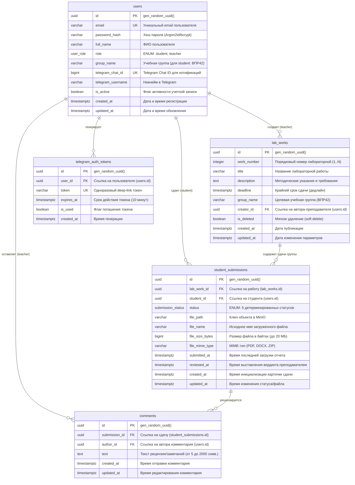

# Спецификация схемы базы данных (ERD) — Проект LabFlow

**Задача ИСР:** 3.1.3. [Аналитик] Описание API (OpenAPI-спецификация), схема БД, матрица ролей и прав доступа  
**Исполнитель:** Пашковский Владимир (Роль: Аналитик) при участии Паршина А. (Lead Dev) и Теплова А. (Backend)  
**Период выполнения:** 4–5 ноября 2026 г.  
**СУБД:** PostgreSQL 16+  
**Статус документа:** Утверждено для реализации миграций и реляционного слоя бэкенда (WBS 4.1.2, 4.2.2, 4.3.2, 4.4.2)  

---

## 1. Введение и архитектурные принципы

Настоящий документ регламентирует реляционную модель данных сервиса отслеживания и сдачи лабораторных работ **LabFlow** для учебной группы ВПР42. 

### Ключевые принципы проектирования:
1. **Нормализация:** База данных спроектирована в третьей нормальной форме (3NF), что исключает избыточность и аномалии модификации данных.
2. **Идентификация сущностей:** В качестве первичных ключей (PK) для всех таблиц используются суррогатные идентификаторы типа `UUID` (`UUIDv4`), генерируемые сервером СУБД с помощью функции `gen_random_uuid()`. Это предотвращает уязвимости перебора идентификаторов (IDOR) и упрощает горизонтальное масштабирование.
3. **Целостность и консистентность:** Бизнес-правила фиксируются на уровне схемы СУБД через ограничения `FOREIGN KEY`, `UNIQUE`, `NOT NULL` и `CHECK`.
4. **Мягкое удаление (Soft Delete):** Удаление лабораторных работ не приводит к каскадной потере академической истории и отчетов студентов — используется логический флаг `is_deleted`.
5. **Аудит времени:** Все таблицы содержат таймстампы создания (`created_at`) и обновления (`updated_at`) с временной зоной (`TIMESTAMPTZ`).
6. **Разделение ответственности с MinIO:** Физические файлы отчетов (PDF, DOCX, ZIP объемом до 20 МБ) хранятся в S3-совместимом объектном хранилище MinIO. В таблицах БД хранятся только метаданные файла, его размер, MIME-тип и уникальный S3-ключ объекта (`file_path`).

---

## 2. Диаграмма связей сущностей (Entity-Relationship Diagram)

Ниже представлена ER-диаграмма, отражающая 4 базовые сущности предметной области (`users`, `lab_works`, `student_submissions`, `comments`), вспомогательную таблицу одноразовых токенов авторизации Telegram (`telegram_auth_tokens`), а также перечисления (`ENUM`).



---

## 3. Детальный словарь данных (Data Dictionary)

### 3.1. Пользовательские типы перечислений (ENUMs)

#### 1. `user_role`
Определяет системную роль пользователя и уровень прав доступа:
- `student` — Студент академической группы (ВПР42). Доступны: просмотр назначенных работ, перевод работы в статус «В работе», загрузка отчетов, чтение комментариев преподавателя, скачивание своего файла.
- `teacher` — Преподаватель/ассистент кафедры. Доступны: создание/редактирование/удаление карточек работ, просмотр общей ведомости группы, скачивание отчетов всех студентов, рецензирование (комментирование) и утверждение вердиктов («Принята» / «На доработке»).

#### 2. `submission_status`
Отражает 5 детерминированных состояний конечного автомата сдачи лабораторной работы:
- `not_started` — «Не начата» (начальное состояние при публикации работы для группы).
- `in_progress` — «В работе» (студент нажал «Взять в работу»).
- `submitted` — «Сдана» (студент прикрепил файл отчета и отправил на проверку).
- `needs_work` — «На доработке» (преподаватель вернул отчет с замечаниями).
- `accepted` — «Принята» (финальное успешное состояние защиты работы).

---

### 3.2. Таблица `users` (Пользователи)

Хранит учетные записи студентов и преподавателей сервиса.

| Поле | Тип данных | Ограничения | Назначение и бизнес-правила |
|---|---|---|---|
| `id` | `UUID` | `PRIMARY KEY DEFAULT gen_random_uuid()` | Суррогатный первичный ключ учетной записи. |
| `email` | `VARCHAR(255)` | `NOT NULL, UNIQUE` | Адрес электронной почты (логин). Индексируется в нижнем регистре. |
| `password_hash` | `VARCHAR(255)` | `NOT NULL` | Криптографический хеш пароля (Argon2id или bcrypt с солью). Сырые пароли никогда не сохраняются. |
| `full_name` | `VARCHAR(150)` | `NOT NULL, CHECK (char_length(trim(full_name)) >= 2)` | Полное имя (ФИО) студента или преподавателя. |
| `role` | `user_role` | `NOT NULL` | Системная роль (`student` или `teacher`). |
| `group_name` | `VARCHAR(50)` | `NULL` | Название учебной группы. **CHECK:** Обязательно заполнено для `role = 'student'` (для MVP фиксировано `'ВПР42'`). Для преподавателя равно `NULL`. |
| `telegram_chat_id` | `BIGINT` | `NULL, UNIQUE` | Уникальный числовой ID чата в Telegram для отправки уведомлений через бота. Заполняется при связке аккаунтов. |
| `telegram_username` | `VARCHAR(100)` | `NULL` | Никнейм пользователя в Telegram (без символа `@`) для визуального отображения в профиле. |
| `is_active` | `BOOLEAN` | `NOT NULL DEFAULT TRUE` | Флаг активности аккаунта (блокировка при отчислении или увольнении). |
| `created_at` | `TIMESTAMPTZ` | `NOT NULL DEFAULT CURRENT_TIMESTAMP` | Метка времени регистрации. |
| `updated_at` | `TIMESTAMPTZ` | `NOT NULL DEFAULT CURRENT_TIMESTAMP` | Метка времени последнего изменения профиля. |

---

### 3.3. Таблица `lab_works` (Лабораторные работы)

Хранит методические описания заданий, дедлайны и привязку к учебной группе.

| Поле | Тип данных | Ограничения | Назначение и бизнес-правила |
|---|---|---|---|
| `id` | `UUID` | `PRIMARY KEY DEFAULT gen_random_uuid()` | Уникальный идентификатор лабораторной работы. |
| `work_number` | `INTEGER` | `NOT NULL, CHECK (work_number > 0)` | Порядковый номер работы в курсе (1, 2, 3...). |
| `title` | `VARCHAR(255)` | `NOT NULL, CHECK (char_length(trim(title)) >= 3)` | Краткая тема/наименование работы (например, «ЛР №1: Основы Git»). |
| `description` | `TEXT` | `NOT NULL` | Полное описание задания, методические указания, формат отчета и критерии защиты. |
| `deadline` | `TIMESTAMPTZ` | `NOT NULL` | Плановый срок сдачи работы. При создании должно удовлетворять: `deadline > created_at`. |
| `group_name` | `VARCHAR(50)` | `NOT NULL DEFAULT 'ВПР42'` | Учебная группа, которой назначена работа. |
| `creator_id` | `UUID` | `NOT NULL, REFERENCES users(id) ON DELETE RESTRICT` | Преподаватель, создавший задание. Удаление преподавателя блокируется при наличии его работ. |
| `is_deleted` | `BOOLEAN` | `NOT NULL DEFAULT FALSE` | Флаг мягкого удаления. Позволяет скрыть работу из активного списка без нарушения целостности сданных отчетов. |
| `created_at` | `TIMESTAMPTZ` | `NOT NULL DEFAULT CURRENT_TIMESTAMP` | Дата и время публикации работы. |
| `updated_at` | `TIMESTAMPTZ` | `NOT NULL DEFAULT CURRENT_TIMESTAMP` | Дата и время последней редакции задания/дедлайна. |

**Составные ограничения:**
- `UNIQUE (group_name, work_number)` среди неудаленных записей (`WHERE is_deleted = FALSE`). В рамках одной группы не может существовать двух активных работ с одинаковым номером.

---

### 3.4. Таблица `student_submissions` (Сдачи работ студентами)

Центральная таблица ведомости успеваемости, связывающая студента с конкретной лабораторной работой и хранящая статус выполнения, а также параметры загруженного файла в MinIO.

| Поле | Тип данных | Ограничения | Назначение и бизнес-правила |
|---|---|---|---|
| `id` | `UUID` | `PRIMARY KEY DEFAULT gen_random_uuid()` | Уникальный идентификатор сдачи. |
| `lab_work_id` | `UUID` | `NOT NULL, REFERENCES lab_works(id) ON DELETE RESTRICT` | Идентификатор лабораторной работы. |
| `student_id` | `UUID` | `NOT NULL, REFERENCES users(id) ON DELETE RESTRICT` | Идентификатор студента. |
| `status` | `submission_status` | `NOT NULL DEFAULT 'not_started'` | Текущий статус работы в конечном автомате. |
| `file_path` | `VARCHAR(512)` | `NULL` | Ключ пути объекта в бакете MinIO: `submissions/{lab_id}/{student_id}/{timestamp}_{filename}`. Заполняется при отправке отчета. |
| `file_name` | `VARCHAR(255)` | `NULL` | Оригинальное имя файла, загруженного студентом (например, `LR1_Ivanov.pdf`). |
| `file_size_bytes` | `BIGINT` | `NULL, CHECK (file_size_bytes IS NULL OR (file_size_bytes > 0 AND file_size_bytes <= 20971520))` | Точный размер файла в байтах. Ограничение: до 20 МБ (20 971 520 байт). |
| `file_mime_type` | `VARCHAR(100)` | `NULL` | MIME-тип файла: `application/pdf`, `application/vnd.openxmlformats-officedocument.wordprocessingml.document`, `application/zip`. |
| `submitted_at` | `TIMESTAMPTZ` | `NULL` | Время последней успешной загрузки файла отчета студентом. |
| `reviewed_at` | `TIMESTAMPTZ` | `NULL` | Время выставления итогового вердикта преподавателем (`accepted` или `needs_work`). |
| `created_at` | `TIMESTAMPTZ` | `NOT NULL DEFAULT CURRENT_TIMESTAMP` | Момент инициализации сдачи (при создании работы или регистрации студента). |
| `updated_at` | `TIMESTAMPTZ` | `NOT NULL DEFAULT CURRENT_TIMESTAMP` | Момент любого изменения статуса или повторной сдачи. |

**Бизнес-ограничения целостности:**
- `UNIQUE (lab_work_id, student_id)`: Студент имеет ровно одну связку с каждой лабораторной работой своей группы.
- **CHECK по консистентности файлов:** Если статус равен `submitted`, `needs_work` или `accepted`, поля `file_path`, `file_name` и `submitted_at` **обязаны быть не NULL**.

---

### 3.5. Таблица `comments` (Комментарии и рецензии)

Хранит замечания и вердикты преподавателя по проверенным отчетам.

| Поле | Тип данных | Ограничения | Назначение и бизнес-правила |
|---|---|---|---|
| `id` | `UUID` | `PRIMARY KEY DEFAULT gen_random_uuid()` | Уникальный идентификатор комментария. |
| `submission_id` | `UUID` | `NOT NULL, REFERENCES student_submissions(id) ON DELETE CASCADE` | Ссылка на проверяемую сдачу. При удалении сдачи комментарии удаляются каскадно. |
| `author_id` | `UUID` | `NOT NULL, REFERENCES users(id) ON DELETE RESTRICT` | Автор рецензии (преподаватель). |
| `text` | `TEXT` | `NOT NULL, CHECK (char_length(trim(text)) >= 5 AND char_length(text) <= 2000)` | Текст комментария. При возврате на доработку обязателен (от 5 до 2000 символов). |
| `created_at` | `TIMESTAMPTZ` | `NOT NULL DEFAULT CURRENT_TIMESTAMP` | Дата и время отправки комментария. |
| `updated_at` | `TIMESTAMPTZ` | `NOT NULL DEFAULT CURRENT_TIMESTAMP` | Дата редактирования комментария (если применимо). |

---

### 3.6. Таблица `telegram_auth_tokens` (Временные токены привязки Telegram)

Обеспечивает безопасный процесс привязки Telegram-аккаунта через deep-link `/start <token>`.

| Поле | Тип данных | Ограничения | Назначение и бизнес-правила |
|---|---|---|---|
| `id` | `UUID` | `PRIMARY KEY DEFAULT gen_random_uuid()` | Идентификатор сессии привязки. |
| `user_id` | `UUID` | `NOT NULL, REFERENCES users(id) ON DELETE CASCADE` | Пользователь LabFlow, запросивший привязку. |
| `token` | `VARCHAR(64)` | `NOT NULL, UNIQUE` | Криптографически стойкая случайная строка (HEX/UUID). |
| `expires_at` | `TIMESTAMPTZ` | `NOT NULL` | Время истечения срока действия токена (TTL = 10 минут). |
| `is_used` | `BOOLEAN` | `NOT NULL DEFAULT FALSE` | Флаг использования (одноразовый токен). |
| `created_at` | `TIMESTAMPTZ` | `NOT NULL DEFAULT CURRENT_TIMESTAMP` | Время генерации. |

---

## 4. Индексация и производительность

Для обеспечения соответствия нефункциональному требованию времени отклика (< 2 с при локальном развертывании) спроектированы следующие индексы:

1. **`idx_users_email_lower`**: `CREATE UNIQUE INDEX idx_users_email_lower ON users (LOWER(email));`
   - Обеспечивает быстрый регистронезависимый поиск при авторизации (UC-01, WBS 4.1.2).
2. **`idx_users_telegram_chat_id`**: `CREATE INDEX idx_users_telegram_chat_id ON users (telegram_chat_id) WHERE telegram_chat_id IS NOT NULL;`
   - Обеспечивает мгновенный поиск пользователя при обработке входящих команд от бота.
3. **`idx_lab_works_group_deadline`**: `CREATE INDEX idx_lab_works_group_deadline ON lab_works (group_name, deadline) WHERE is_deleted = FALSE;`
   - Оптимизирует выборку списка активных работ группы, упорядоченных по приближению дедлайна (UC-03).
4. **`idx_submissions_student`**: `CREATE INDEX idx_submissions_student ON student_submissions (student_id, status);`
   - Ускоряет генерацию персонального дашборда студента и фильтрацию по статусу (UC-03, US-04).
5. **`idx_submissions_lab_status`**: `CREATE INDEX idx_submissions_lab_status ON student_submissions (lab_work_id, status);`
   - Оптимизирует построение сводной ведомости группы для преподавателя и фильтрацию работ, требующих проверки (`status = 'submitted'`) (UC-05, US-07).
6. **`idx_comments_submission_created`**: `CREATE INDEX idx_comments_submission_created ON comments (submission_id, created_at ASC);`
   - Обеспечивает хронологический вывод диалога замечаний в карточке сдачи (UC-06).
7. **`idx_telegram_tokens_lookup`**: `CREATE INDEX idx_telegram_tokens_lookup ON telegram_auth_tokens (token) WHERE is_used = FALSE;`
   - Быстрая проверка токена при переходе по ссылке в боте (UC-07).

---

## 5. DDL-скрипт инициализации базы данных (PostgreSQL)

Скрипт полностью готов для включения в миграции Alembic или файл инициализации контейнера Docker Compose `init-db.sql`.

```sql
-- 1. Подключение расширения для генерации UUIDv4
CREATE EXTENSION IF NOT EXISTS "pgcrypto";

-- 2. Создание типов перечислений
DO $$ BEGIN
    CREATE TYPE user_role AS ENUM ('student', 'teacher');
EXCEPTION
    WHEN duplicate_object THEN NULL;
END $$;

DO $$ BEGIN
    CREATE TYPE submission_status AS ENUM (
        'not_started',
        'in_progress',
        'submitted',
        'needs_work',
        'accepted'
    );
EXCEPTION
    WHEN duplicate_object THEN NULL;
END $$;

-- 3. Функция автоматического обновления updated_at
CREATE OR REPLACE FUNCTION update_updated_at_column()
RETURNS TRIGGER AS $$
BEGIN
    NEW.updated_at = CURRENT_TIMESTAMP;
    RETURN NEW;
END;
$$ LANGUAGE plpgsql;

-- 4. Таблица users
CREATE TABLE IF NOT EXISTS users (
    id UUID PRIMARY KEY DEFAULT gen_random_uuid(),
    email VARCHAR(255) NOT NULL,
    password_hash VARCHAR(255) NOT NULL,
    full_name VARCHAR(150) NOT NULL CHECK (char_length(trim(full_name)) >= 2),
    role user_role NOT NULL,
    group_name VARCHAR(50) NULL,
    telegram_chat_id BIGINT NULL UNIQUE,
    telegram_username VARCHAR(100) NULL,
    is_active BOOLEAN NOT NULL DEFAULT TRUE,
    created_at TIMESTAMPTZ NOT NULL DEFAULT CURRENT_TIMESTAMP,
    updated_at TIMESTAMPTZ NOT NULL DEFAULT CURRENT_TIMESTAMP,
    CONSTRAINT chk_student_group CHECK (
        (role = 'student' AND group_name IS NOT NULL AND char_length(trim(group_name)) > 0) OR
        (role = 'teacher')
    )
);

CREATE UNIQUE INDEX IF NOT EXISTS idx_users_email_lower ON users (LOWER(email));
CREATE INDEX IF NOT EXISTS idx_users_telegram_chat_id ON users (telegram_chat_id) WHERE telegram_chat_id IS NOT NULL;

-- 5. Таблица lab_works
CREATE TABLE IF NOT EXISTS lab_works (
    id UUID PRIMARY KEY DEFAULT gen_random_uuid(),
    work_number INTEGER NOT NULL CHECK (work_number > 0),
    title VARCHAR(255) NOT NULL CHECK (char_length(trim(title)) >= 3),
    description TEXT NOT NULL,
    deadline TIMESTAMPTZ NOT NULL,
    group_name VARCHAR(50) NOT NULL DEFAULT 'ВПР42',
    creator_id UUID NOT NULL REFERENCES users(id) ON DELETE RESTRICT,
    is_deleted BOOLEAN NOT NULL DEFAULT FALSE,
    created_at TIMESTAMPTZ NOT NULL DEFAULT CURRENT_TIMESTAMP,
    updated_at TIMESTAMPTZ NOT NULL DEFAULT CURRENT_TIMESTAMP
);

CREATE UNIQUE INDEX IF NOT EXISTS idx_lab_works_group_number_active 
ON lab_works (group_name, work_number) WHERE is_deleted = FALSE;

CREATE INDEX IF NOT EXISTS idx_lab_works_group_deadline 
ON lab_works (group_name, deadline) WHERE is_deleted = FALSE;

-- 6. Таблица student_submissions
CREATE TABLE IF NOT EXISTS student_submissions (
    id UUID PRIMARY KEY DEFAULT gen_random_uuid(),
    lab_work_id UUID NOT NULL REFERENCES lab_works(id) ON DELETE RESTRICT,
    student_id UUID NOT NULL REFERENCES users(id) ON DELETE RESTRICT,
    status submission_status NOT NULL DEFAULT 'not_started',
    file_path VARCHAR(512) NULL,
    file_name VARCHAR(255) NULL,
    file_size_bytes BIGINT NULL CHECK (file_size_bytes IS NULL OR (file_size_bytes > 0 AND file_size_bytes <= 20971520)),
    file_mime_type VARCHAR(100) NULL,
    submitted_at TIMESTAMPTZ NULL,
    reviewed_at TIMESTAMPTZ NULL,
    created_at TIMESTAMPTZ NOT NULL DEFAULT CURRENT_TIMESTAMP,
    updated_at TIMESTAMPTZ NOT NULL DEFAULT CURRENT_TIMESTAMP,
    CONSTRAINT uq_lab_student UNIQUE (lab_work_id, student_id),
    CONSTRAINT chk_submission_file_consistency CHECK (
        (status IN ('not_started', 'in_progress')) OR
        (status IN ('submitted', 'needs_work', 'accepted') AND file_path IS NOT NULL AND file_name IS NOT NULL AND submitted_at IS NOT NULL)
    )
);

CREATE INDEX IF NOT EXISTS idx_submissions_student ON student_submissions (student_id, status);
CREATE INDEX IF NOT EXISTS idx_submissions_lab_status ON student_submissions (lab_work_id, status);

-- 7. Таблица comments
CREATE TABLE IF NOT EXISTS comments (
    id UUID PRIMARY KEY DEFAULT gen_random_uuid(),
    submission_id UUID NOT NULL REFERENCES student_submissions(id) ON DELETE CASCADE,
    author_id UUID NOT NULL REFERENCES users(id) ON DELETE RESTRICT,
    text TEXT NOT NULL CHECK (char_length(trim(text)) >= 5 AND char_length(text) <= 2000),
    created_at TIMESTAMPTZ NOT NULL DEFAULT CURRENT_TIMESTAMP,
    updated_at TIMESTAMPTZ NOT NULL DEFAULT CURRENT_TIMESTAMP
);

CREATE INDEX IF NOT EXISTS idx_comments_submission_created ON comments (submission_id, created_at ASC);

-- 8. Таблица telegram_auth_tokens
CREATE TABLE IF NOT EXISTS telegram_auth_tokens (
    id UUID PRIMARY KEY DEFAULT gen_random_uuid(),
    user_id UUID NOT NULL REFERENCES users(id) ON DELETE CASCADE,
    token VARCHAR(64) NOT NULL UNIQUE,
    expires_at TIMESTAMPTZ NOT NULL,
    is_used BOOLEAN NOT NULL DEFAULT FALSE,
    created_at TIMESTAMPTZ NOT NULL DEFAULT CURRENT_TIMESTAMP
);

CREATE INDEX IF NOT EXISTS idx_telegram_tokens_lookup ON telegram_auth_tokens (token) WHERE is_used = FALSE;

-- 9. Триггеры обновления updated_at
DROP TRIGGER IF EXISTS trg_users_updated_at ON users;
CREATE TRIGGER trg_users_updated_at BEFORE UPDATE ON users
FOR EACH ROW EXECUTE FUNCTION update_updated_at_column();

DROP TRIGGER IF EXISTS trg_lab_works_updated_at ON lab_works;
CREATE TRIGGER trg_lab_works_updated_at BEFORE UPDATE ON lab_works
FOR EACH ROW EXECUTE FUNCTION update_updated_at_column();

DROP TRIGGER IF EXISTS trg_student_submissions_updated_at ON student_submissions;
CREATE TRIGGER trg_student_submissions_updated_at BEFORE UPDATE ON student_submissions
FOR EACH ROW EXECUTE FUNCTION update_updated_at_column();

DROP TRIGGER IF EXISTS trg_comments_updated_at ON comments;
CREATE TRIGGER trg_comments_updated_at BEFORE UPDATE ON comments
FOR EACH ROW EXECUTE FUNCTION update_updated_at_column();
```

---

## 6. Трассировка схемы данных к требованиям ТЗ и ИСР

| Таблица БД | Покрываемые требования ТЗ | Прецеденты (Use Cases) | Задачи ИСР (WBS) |
|---|---|---|---|
| `users` | **FR-01** (Аутентификация/роли), **FR-06** (Telegram chat_id) | UC-01, UC-07 | 4.1.2, 4.5.2 |
| `lab_works` | **FR-02** (CRUD работ, дедлайны, группа ВПР42) | UC-02 | 4.2.2 |
| `student_submissions` | **FR-03** (5 статусов), **FR-04** (файлы MinIO), **FR-07** (список студента), **FR-08** (ведомость преподавателя) | UC-03, UC-04, UC-05, UC-06 | 4.2.2, 4.3.2, 4.4.2 |
| `comments` | **FR-05** (Рецензирование и замечания) | UC-06 | 4.4.2, 4.4.3 |
| `telegram_auth_tokens`| **FR-06** (Привязка Telegram через deep-link) | UC-07 | 4.5.2 |

---

## 7. Рекомендации для команды разработки
- **Для Backend (Теплов А.) / Lead Dev (Паршин А.):**
  - При создании лабораторной работы (`POST /api/v1/labs`) бэкенд в рамках одной транзакции должен создавать запись в `lab_works` и генерировать записи `student_submissions` со статусом `not_started` для всех активных студентов указанной группы (`group_name = 'ВПР42'`).
  - При повторной регистрации студента в группу ВПР42 система должна автоматически создавать для него записи в `student_submissions` по всем активным (`is_deleted = FALSE`) лабораторным работам.
  - Удаление лабораторной работы (`DELETE /api/v1/labs/{id}`) обязательно реализуется как мягкое удаление: `UPDATE lab_works SET is_deleted = TRUE WHERE id = :id`.
- **Для QA (Кулов Д.):**
  - Включить в план негативного тестирования проверку ограничений:
    1. Попытка создания двух активных работ с одинаковым номером для группы ВПР42 (ошибка 409/400).
    2. Попытка отправки комментария короче 5 символов при отправке на доработку (ошибка 400).
    3. Попытка перевода в статус `submitted` без прикрепленного файла (нарушение `chk_submission_file_consistency`).
    4. Превышение лимита размера файла в 20 МБ.
