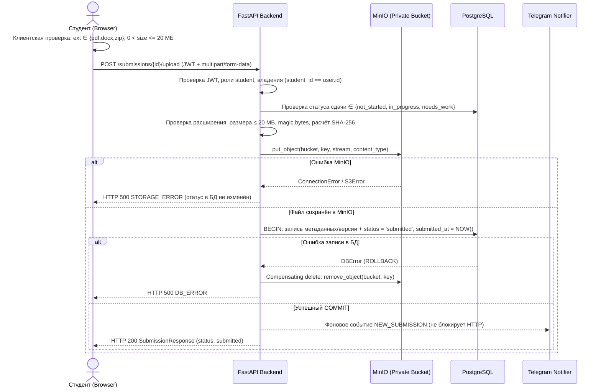

# Требования к загрузке и скачиванию файлов (MinIO / S3) — Проект LabFlow

**Задача ИСР:** [[wbs-4-4-1|4.4.1. [Аналитик] Требования к загрузке/скачиванию файлов, политики доступа (pre-signed URL), ограничения по типам/размерам]]  
**Исполнитель:** Пашковский Владимир (Роль: Аналитик)  
**Дата выполнения:** 11 ноября 2026 г.  
**Получатели артефакта:** Теплов А. (Backend MinIO — `4.4.2`, `4.4.3`), Пашковский В. (Frontend — `4.4.4`, `4.4.5`), Кулов Д. (QA — `4.4.6`, `4.4.7`), Паршин А. (Lead Dev — `4.6.1`)  
**Статус документа:** Утверждено для проектирования хранилища (4.4.2), детализации контрактов (4.4.8) и разработки тест-кейсов (4.4.6)  
**Связанные документы:** [[Use Cases]], [[User Stories]], [[Матрица ролей и прав доступа]], [[Спецификация API (OpenAPI)]], [[Схема базы данных (ERD)]], [[Матрица трассировки требований (RTM)]]

---

## 1. Назначение и область действия

Настоящий документ детализирует функциональные, нефункциональные и безопасностные требования к подсистеме работы с файлами отчётов лабораторных работ в сервисе **LabFlow** (покрывает требования [[Высокоуровневые требования#Функциональные требования|FR-04]], [[Высокоуровневые требования#Нефункциональные требования|NFR-04]], пользовательские истории [[User Stories#US-06: Загрузка файла отчета студентом|US-06]], [[User Stories#US-07: Просмотр ведомости сдачи и скачивание отчетов преподавателем|US-07]], [[User Stories#US-09: Повторная сдача работы после доработки|US-09]], прецеденты [[Use Cases#UC-04: Сдача отчёта по лабораторной работе|UC-04]], [[Use Cases#UC-05: Проверка сданных работ и ведомость группы (Преподаватель)|UC-05]]).

### Базовый принцип архитектуры:
- Клиентское приложение (`React`) **никогда** не обращается к S3/MinIO с сервисными ключами доступа (`MINIO_ROOT_USER` / `MINIO_ROOT_PASSWORD`) и **не имеет** публичного доступа к бакету.
- **Загрузка отчёта** выполняется через проксирующий эндпоинт бэкенда (`FastAPI`) по `multipart/form-data`, чтобы гарантировать серверную проверку прав, размера, сигнатуры файла (magic bytes), вычисление хеша и атомарный перевод статуса в `submitted`.
- **Скачивание отчёта** выполняется по временному криптографически подписанному URL (**Pre-signed GET URL**), который бэкенд формирует после проверки RBAC/ABAC.

---

## 2. Организация объектного хранилища MinIO

### 2.1. Конфигурация бакета и окружения
В соответствии с `.env.example` целевой бакет задаётся переменной окружения:
- **`MINIO_BUCKET_REPORTS`** (значение по умолчанию: `labflow-reports`; ранее в черновиках встречалось имя `labflow-submissions` — унифицируется в пользу `MINIO_BUCKET_REPORTS`).
- **Политика доступа к бакету:** строго **Private** (анонимный `s3:GetObject`, `s3:PutObject`, `s3:ListBucket` **запрещён**).
- При старте бэкенда (или в init-скрипте `4.4.2`) проверяется наличие бакета; при отсутствии бакет создаётся автоматически с приватной политикой.

### 2.2. Именование объектов (Object Key Convention)
Ключ объекта в бакете должен быть детерминированным, защищённым от коллизий при повторных сдачах и не должен зависеть от небезопасных символов в пользовательском имени файла:

```text
submissions/{lab_work_id}/{student_id}/{utc_timestamp}_{short_uuid}_{sanitized_filename}
```

Пример:
```text
submissions/12/45/20261111T143025Z_a3f9c1b2_LR1_Ivanov_VPR42.pdf
```

**Правила формирования ключа:**
1. `{utc_timestamp}` — время загрузки в UTC формата `YYYYMMDDTHHMMSSZ` (обеспечивает хронологическую сортировку версий).
2. `{short_uuid}` — 8 hex-символов (`uuid4().hex[:8]`), исключает коллизии при одновременных запросах.
3. `{sanitized_filename}` — исходное имя файла (до 120 символов), очищенное от:
   - разделителей путей (`/`, `\`), последовательностей `..` (защита от Path Traversal);
   - null-байтов (`\x00`) и управляющих символов;
   - небезопасных спецсимволов (допускаются буквы, цифры, `.`, `_`, `-`, пробелы заменяются на `_`).
4. Оригинальное отображаемое имя (например, `Отчёт ЛР1 Иванов.pdf`) сохраняется отдельно в поле БД `file_name` (до 255 символов) и используется только в заголовке `Content-Disposition` при скачивании.

---

## 3. Ограничения по типам, размерам и валидации файлов

Все проверки выполняются **двухуровнево**: на стороне клиента (`React` — для мгновенного UX до отправки трафика) и **строго обязательно** на стороне сервера (`FastAPI` — в соответствии с [[Definition of Done#2. DoD уровня User Story (US-01…US-12)|DoD D5]], обход UI через `curl`/Postman не должен позволять загрузку запрещённых файлов).

### 3.1. Допустимые форматы (Allowlist)

| Расширение | Назначение | Допустимые MIME-типы (`Content-Type`) | Сигнатура файла (Magic Bytes) | Дополнительная серверная проверка |
|---|---|---|---|---|
| **`.pdf`** | Отчёт в формате PDF | `application/pdf` | Первые 5 байт: `%PDF-` (`25 50 44 46 2D`) | Запрет пустого файла |
| **`.docx`** | Документ Microsoft Word (OOXML) | `application/vnd.openxmlformats-officedocument.wordprocessingml.document` | ZIP-контейнер: `PK\x03\x04` (`50 4B 03 04`) | Проверка наличия внутри архива структуры OOXML (`[Content_Types].xml` и каталога `word/`) — исключает загрузку произвольного `.zip` под видом `.docx` |
| **`.zip`** | Архив с отчётом и исходниками | `application/zip`, `application/x-zip-compressed` | `PK\x03\x04` (`50 4B 03 04`) или пустой архив (отклоняется, если 0 файлов) | Проверка корректности ZIP-заголовка через `zipfile.is_zipfile`; проверка защиты от zip-bomb при наличии распаковки (в MVP архив не распаковывается на сервере) |

**Запрещённые форматы:** любые другие расширения (`.doc`, `.rar`, `.7z`, `.txt`, `.exe`, `.bat`, `.sh`, `.js`, `.html`, `.svg`, `.php`, `.py` и др.), а также файлы с двойным подозрительным расширением, заканчивающимся не на разрешённый тип (например, `report.pdf.exe`).

### 3.2. Ограничения по размеру файла
- **Минимальный размер:** строго **> 0 байт** (минимально допустимый непустой файл — 1 байт с валидной структурой для формата; пустой файл 0 байт отклоняется).
- **Максимальный размер:** строго **20 МБ = 20 × 1024 × 1024 = 20 971 520 байт**.
  - Граничное значение **`20 971 520` байт** (ровно 20 МБ) — **разрешено** (`TC-FILE-002`).
  - Размер **`20 971 521` байт** и более — **отклоняется** (`TC-FILE-003`).
- **Контроль на уровне потока:** сервер должен читать/проверять объём входящего файла инкрементально (с ограничением лимита до полного буферизирования в RAM), чтобы предотвратить исчерпание памяти при отправке гигантских файлов.
- **Инфраструктурное требование к Nginx (`frontend/nginx.conf`):** так как по умолчанию Nginx ограничивает тело запроса значением `1m`, для прокси `/api/` необходимо задать `client_max_body_size 21m;` (чтобы запрос до 20 МБ + multipart-заголовки доходил до FastAPI и корректно валидировался приложением).

### 3.3. Матрица ошибок валидации при загрузке

| Нарушение | HTTP-код | Код ошибки (`ErrorResponse.code`) | Сообщение для пользователя |
|---|---|---|---|
| Файл не прикреплён или пустой (0 байт) | `400 Bad Request` | `EMPTY_FILE` | «Файл отчёта не выбран или является пустым» |
| Недопустимое расширение / MIME-тип / несоответствие magic bytes | `400 Bad Request` | `INVALID_FILE_TYPE` | «Допустимы только корректные файлы форматов PDF, DOCX, ZIP» |
| Превышен размер 20 МБ (`> 20 971 520` байт) | `400 Bad Request` *(или `413 Payload Too Large`)* | `FILE_TOO_LARGE` | «Размер файла не должен превышать 20 МБ» |
| Недопустимое состояние сдачи (`submitted` или `accepted`) | `409 Conflict` | `INVALID_SUBMISSION_STATE` | «Повторная загрузка недоступна: работа уже сдана или принята» |

> **Примечание для Backend/Frontend (`4.4.3`, `4.4.5`, `4.4.8`):** в действующем `openapi.yaml` ошибки валидации загрузки сведены к `400 Bad Request` с телом `ErrorResponse`. Рекомендуется использовать `400` с кодами `INVALID_FILE_TYPE`, `FILE_TOO_LARGE`, `EMPTY_FILE` (либо при использовании `413` для `FILE_TOO_LARGE` синхронизировать это в `4.4.8` и обработать оба кода на фронтенде).

---

## 4. Процесс загрузки, версионность и атомарность (БД + MinIO)

### 4.1. Диаграмма последовательности загрузки отчёта



### 4.2. Версионность и повторная сдача после доработки (`US-09`, `TC-FILE-005`)
1. При первой сдаче (из `not_started` или `in_progress`) объект загружается по новому ключу, статус сдачи переходит в `submitted`.
2. При возврате на доработку (`needs_work`) студент получает право загрузить исправленный отчёт (`US-09`, `AC 9.1`).
3. **Политика хранения старых версий:** при повторной загрузке предыдущий объект в MinIO **не удаляется**, так как новый файл сохраняется под уникальным ключом с новой меткой времени `{utc_timestamp}`. В БД (`wbs-4-4-2` — таблица `reports` / связь со сдачей) фиксируются версия отчёта (`version_number`), `file_path`, `file_name`, `file_size_bytes`, `file_mime_type`, `file_sha256`, `uploaded_at`, а на самой сдаче `student_submissions` хранится ссылка на актуальный отчёт.
4. Пока работа находится в статусах `submitted` или `accepted`, повторная загрузка заблокирована на клиенте (скрытие/блокировка формы) и на сервере (`409 Conflict`).

### 4.3. Целостность файлов и отказоустойчивость (`DoD D7`, `TC-FILE-006`)
- При загрузке сервер вычисляет **SHA-256** контрольную сумму файла и сохраняет её в метаданных отчёта в БД (позволяет QA в задаче `4.4.6` верифицировать побитовую целостность при скачивании).
- При сбое записи в MinIO транзакция БД не выполняется (`status` и прежняя версия файла остаются неизменными).
- При сбое PostgreSQL после успешного `put_object` в MinIO выполняется компенсирующее удаление загруженного «осиротевшего» объекта из бакета.

---

## 5. Политики доступа и механизм Pre-signed URL

### 5.1. Матрица прав доступа к файловым операциям

| Операция | Аноним | Студент (владелец сдачи) | Студент (чужая сдача) | Преподаватель |
|---|:---:|:---:|:---:|:---:|
| Загрузка файла (`POST .../upload`) | `401` | ✅ Разрешено (в статусах `not_started`, `in_progress`, `needs_work`) | `403 Forbidden` | `403 Forbidden` |
| Получение ссылки скачивания (`GET .../download-url`) | `401` | ✅ Разрешено (только свой загруженный файл) | `403 Forbidden` | ✅ Разрешено (файл любого студента группы) |
| Просмотр списка версий / метаданных отчёта | `401` | ✅ Разрешено (своей сдачи) | `403 Forbidden` | ✅ Разрешено |
| Прямой запрос к бакету MinIO без подписи | ❌ `403 AccessDenied` | ❌ `403 AccessDenied` | ❌ `403 AccessDenied` | ❌ `403 AccessDenied` |

### 5.2. Требования к генерации и безопасности Pre-signed URL
1. **Метод подписи:** только `GET` (`presigned_get_object` / AWS Signature Version 4). Выдача `PUT` pre-signed URL в браузер в MVP не используется.
2. **Время жизни ссылки (TTL):** строго **15 минут (900 секунд)** (`expires=timedelta(seconds=900)`). В ответе API обязательно возвращается `expires_in_seconds: 900`.
3. **Принудительное скачивание (Anti-XSS):** при генерации pre-signed URL бэкенд должен передавать override-параметры ответа:
   - `response-content-disposition`: `attachment; filename*=UTF-8''<url_encoded_original_filename>` (браузер скачивает файл, а не исполняет потенциально опасный контент в origin хранилища).
   - `response-content-type`: сохранённый `file_mime_type` (или `application/octet-stream`).
4. **Поведение при отсутствии файла:** если у сдачи (например, статус `not_started` или `in_progress`) ещё нет загруженного отчёта, `GET .../download-url` возвращает `400 Bad Request` (`FILE_NOT_UPLOADED`) или `404 Not Found`.
5. **Поведение при истечении TTL:** спустя 900 секунд после генерации запрос по старой ссылке напрямую к MinIO отклоняется самим MinIO с кодом `403 AccessDenied` (`Request has expired`). Для повторного скачивания пользователь должен заново запросить новый pre-signed URL через бэкенд (пройдя проверку JWT и прав доступа).
6. **Требование к Docker-сети (`4.4.2`, `4.4.3`):** так как в Docker Compose бэкенд обращается к MinIO по внутреннему имени `minio:9000`, а браузер пользователя скачивает по внешнему адресу (например, `localhost:9000` или через reverse-proxy `/minio/`), генерация AWS SigV4 подписи **обязана** выполняться для того же `Host`, по которому к ссылке обратится браузер (например, через отдельный config-параметр `MINIO_PUBLIC_ENDPOINT` или проксирование пути в Nginx), иначе подпись будет невалидной (`SignatureDoesNotMatch`).

---

## 6. Критерии приёмки модуля работы с файлами (вход для WBS 4.4.6 и 4.4.8)

| ID проверки | Сценарий | Ожидаемый результат | Связь с ТК QA |
|---|---|---|---|
| **FR-04.1** | Загрузка валидных `.pdf`, `.docx`, `.zip` (в т.ч. через drag-and-drop) | HTTP 200, файл в приватном бакете MinIO, вычислен SHA-256, статус -> `submitted` | `TC-FILE-001` |
| **FR-04.2** | Загрузка файла размером ровно `20 971 520` байт (20 МБ) | HTTP 200, загрузка успешна | `TC-FILE-002` |
| **FR-04.3** | Загрузка файла размером `20 971 521` байт (> 20 МБ) в обход UI | Отклонение на клиенте и на сервере (`FILE_TOO_LARGE`), файл не сохранён | `TC-FILE-003` |
| **FR-04.4** | Загрузка запрещённого типа (`.exe`, `.txt`) и файла с подменённым расширением (`.exe` ➔ `.pdf`) | Отклонение сервером по magic bytes (`INVALID_FILE_TYPE`), HTTP 400 | `TC-FILE-004` |
| **FR-04.5** | Загрузка файла 0 байт | Отклонение (`EMPTY_FILE`), HTTP 400 | Дополнить в `4.4.6` |
| **FR-04.6** | Загрузка в статусах `submitted` / `accepted` | Блокировка на UI и HTTP 409 на сервере | Дополнить в `4.4.6` |
| **FR-04.7** | Повторная сдача после `needs_work` | Новая версия сохранена, предыдущая не утеряна, статус -> `submitted` | `TC-FILE-005` |
| **FR-04.8** | Сбой MinIO при загрузке | HTTP 500, статус в БД не изменился, частичных данных нет | `TC-FILE-006` |
| **FR-04.9** | Скачивание отчёта через pre-signed URL и проверка SHA-256 | Файл скачивается с исходным именем, контрольная сумма совпадает | `TC-GRADE-003` |
| **FR-04.10** | Попытка скачать/загрузить файл чужого студента или без токена; прямой доступ к URL MinIO; истекший (> 15 мин) URL | `401` без токена, `403` на чужую сдачу, `403 AccessDenied` в MinIO без подписи или по истечении 900 сек | `TC-GRADE-005` + дополнить в `4.4.6` |
